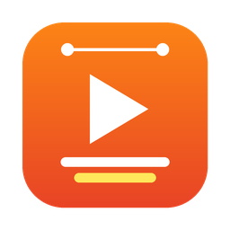

# TorVideoPlayer

Плеер для macOS, который воспроизводит торренты **онлайн, не дожидаясь полной загрузки** (как Ace Stream / Soda Player), на базе **VLC** (VLCKit) с поддержкой **двойных субтитров**.



## Возможности

- **Magnet-ссылки, .torrent файлы, ссылки на .torrent, info-hash** — вставьте, перетащите в окно или откройте двойным кликом (приложение регистрируется как обработчик `magnet:` и `.torrent`).
- **Стриминг во время загрузки**: в первую очередь качаются куски файла, которые сейчас смотрит плеер. Перемотка работает сразу — загрузка переключается на новую позицию.
- **VLC внутри**: MKV, AVI, MP4, HEVC/H.265, AC3/DTS, несколько звуковых дорожек — всё, что умеет VLC.
- **Двойные субтитры**: одновременно две дорожки (например, английские + русские для изучения языка):
  - встроенные в видео дорожки (рисует VLC) + внешние файлы `.srt / .ass / .ssa / .vtt` (рисует сам плеер);
  - или два внешних файла одновременно;
  - субтитры из самого торрента подхватываются автоматически (в т.ч. из папок `Subs`);
  - автоматический выбор по языкам (по умолчанию: 1 — русский, 2 — английский, меняется в настройках);
  - отдельная задержка для каждой дорожки, цвет и положение вторых субтитров (сверху экрана или над первыми), размер шрифта, подложка;
  - кодировки UTF‑8, UTF‑16 и Windows‑1251 (старые русские .srt) определяются автоматически.
- **Сериалы**: список файлов раздачи, кнопка «следующая серия» и автопереход к следующему файлу.
- Статистика: пиры, скорость, сколько скачано.
- Недавние торренты на главном экране.
- Локальные видеофайлы и прямые http-ссылки на видео тоже открываются.
- Universal-сборка: Apple Silicon (M1–M4) и Intel, macOS 13 Ventura и новее.

## Установка

1. Скачайте `TorVideoPlayer.dmg` из [Releases](https://github.com/Arthuralend/TorVideoPlayer/releases) (или из артефактов последней сборки во вкладке [Actions](https://github.com/Arthuralend/TorVideoPlayer/actions)).
2. Перетащите **TorVideoPlayer** в «Программы».
3. Приложение не подписано сертификатом Apple, поэтому при первом запуске macOS его заблокирует. Выполните в Терминале один раз:
   ```bash
   xattr -dr com.apple.quarantine /Applications/TorVideoPlayer.app
   ```
   (или: правый клик по приложению → «Открыть» → «Открыть»; на macOS 15 — «Системные настройки → Конфиденциальность и безопасность → Всё равно открыть»).

## Горячие клавиши

| Клавиша | Действие |
|---|---|
| Пробел / клик | Пауза / воспроизведение |
| ← / → | −10 / +10 секунд (с Shift — 60 секунд) |
| ↑ / ↓ | Громкость |
| F, Enter, двойной клик | Полный экран (Esc — выход) |
| M | Без звука |
| S / D | Переключить субтитры 1 / субтитры 2 |
| Z / X | Задержка субтитров 1 −0,1 / +0,1 с |
| C / V | Задержка субтитров 2 −0,1 / +0,1 с |
| N | Следующий файл |
| [ / ] / \ | Медленнее / быстрее / обычная скорость |
| ⌘O | Открыть файл |
| ⇧⌘V | Открыть ссылку из буфера обмена |
| ⇧⌘S | Загрузить субтитры из файла |

Клавиши работают при любой раскладке (в т.ч. русской). Файл субтитров можно просто перетащить на окно с видео.

## Как это устроено

```
┌──────────────────────── TorVideoPlayer.app ────────────────────────┐
│ SwiftUI интерфейс                                                  │
│   ├─ VLCKit (libVLC 3) ── http://127.0.0.1:PORT/stream/… ──┐       │
│   └─ свой рендер субтитров (SRT/ASS/VTT) поверх видео      │       │
│                                                            ▼       │
│ torengine (Go, anacrolix/torrent) — локальный HTTP-сервер с Range, │
│   приоритет загрузки кусков вокруг позиции воспроизведения         │
└────────────────────────────────────────────────────────────────────┘
```

- `engine/` — торрент-движок на Go: DHT, трекеры, PEX, uTP/TCP. Отдаёт файлы по HTTP с поддержкой Range, поэтому VLC может перематывать. Сам завершается вместе с приложением и удаляет временные файлы (их можно сохранять — см. настройки).
- `App/Sources/` — приложение на Swift/SwiftUI + VLCKit.

Загрузки лежат в `~/Library/Caches/TorVideoPlayer/Downloads` и удаляются при выходе (если не включено «Сохранять скачанные файлы»). Лог движка: `~/Library/Caches/TorVideoPlayer/engine.log`.

### Про Ace Stream

Ссылки `acestream://…` работают через собственную P2P-сеть Ace Stream, а не BitTorrent. Нативного Ace Stream для macOS нет; если запустить Ace Stream Engine (например, в Docker на порту 6878), TorVideoPlayer воспроизведёт `acestream://ID` через него. Обычные торренты (magnet / .torrent) работают без каких-либо дополнительных программ.

## Сборка из исходников

Нужны Xcode 15+, Go, XcodeGen и CocoaPods:

```bash
brew install go xcodegen cocoapods
git clone https://github.com/Arthuralend/TorVideoPlayer.git
cd TorVideoPlayer
./scripts/build-app.sh          # → build/TorVideoPlayer.app и build/TorVideoPlayer.dmg
```

Для разработки: `./scripts/build-engine.sh && xcodegen generate && pod install`, затем откройте `TorVideoPlayer.xcworkspace` в Xcode.

Каждый push собирается в GitHub Actions (macOS), тег `v*` публикует релиз с DMG.

## Другие программы для macOS (для сравнения)

- **Stremio** (+ аддон Torrentio) — стриминг торрентов, есть Mac-версия.
- **WebTorrent Desktop** — простой торрент-плеер, но видит в основном пиров WebTorrent и плохо работает с MKV/HEVC.
- **TorrServer** + **IINA**/VLC — сервер торрент-стриминга + внешний плеер (IINA умеет вторые субтитры).
- **Soda Player** — похожая идея, но давно не обновляется.

## Лицензия

Код проекта — MIT. VLCKit/libVLC распространяются по LGPL 2.1+, anacrolix/torrent — MPL 2.0.

Используйте программу для контента, на просмотр которого у вас есть права.
